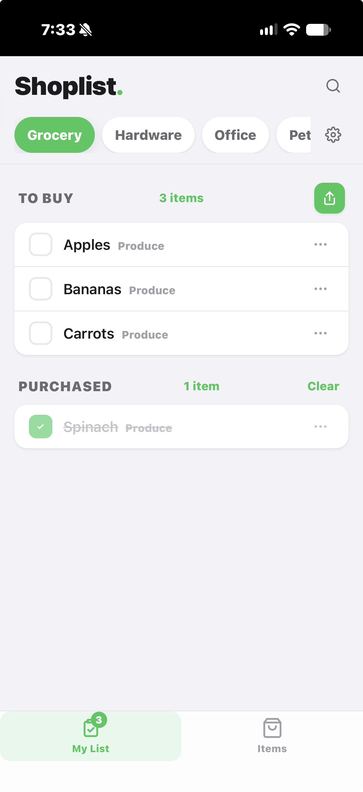
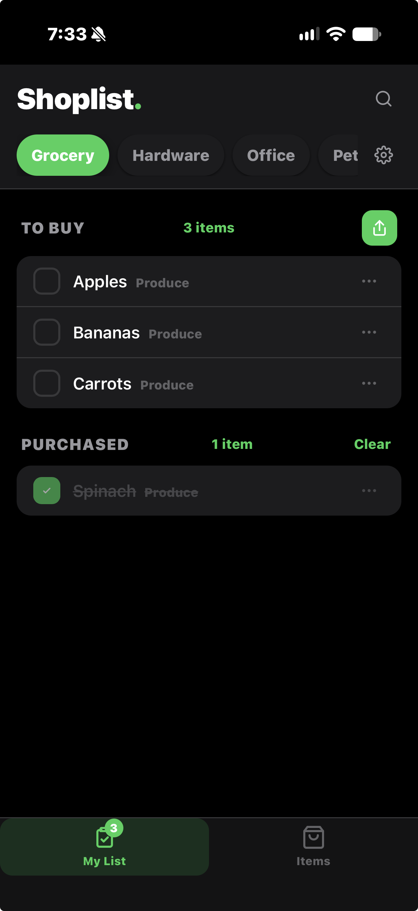
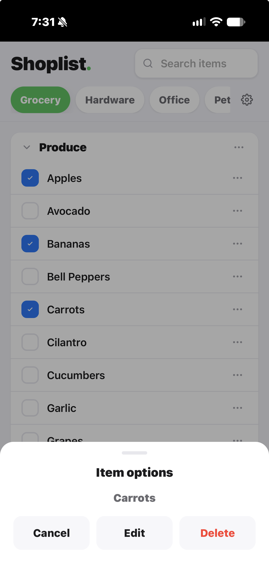
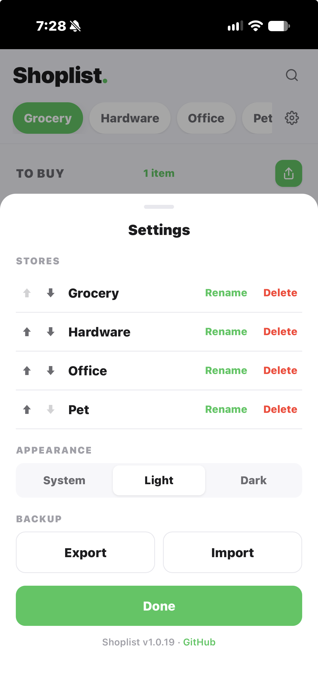
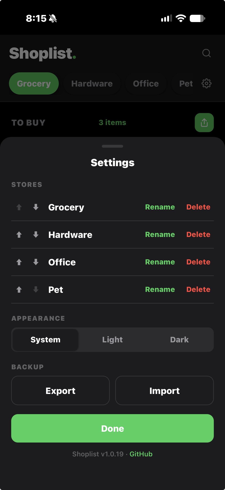
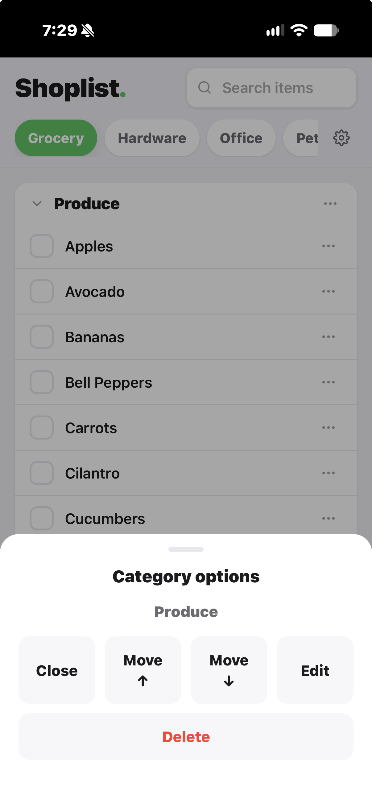

# Shoplist 🧾

A small, **local-first** shopping list app that lives in your phone's browser.

Shoplist is a [Progressive Web App (PWA)](https://developer.mozilla.org/en-US/docs/Web/Progressive_web_apps) — a single `index.html` file with no backend, no accounts, and no build step. It looks and feels like a native app, works offline, and keeps all of your data on your own device in the browser's `localStorage`.

This app was built as an initial exercise in using a local LLM to create a usable phone app. All of the coding was done with LM Studio using Cline as an agent with the model Qwen3.8-27b.

```
Shopping list — Whole Foods:
- Spinach (Produce)
- Milk (Dairy)
- Eggs (Dairy)
```

---

## ✨ Features

- **Organized by store and category** — keep separate lists per shop (Grocery, Pharmacy, …), each with its own categories (Produce, Dairy, …).
- **Comprehensive starter data** — ships with **4 stores**, **22 categories**, and **195 items** covering grocery staples, hardware, office supplies, and pet care.
- **Two views**
  - **Items** — your stores, categories, and items. Checking an item *selects* it for your list.
  - **My List** — the items you've selected, split into **To buy** and **Purchased**. Checking here marks something bought.
- **Share the list** — one tap opens your phone's native share sheet with your to-buy items (and a cart card image), or falls back to an SMS / copy sheet.
- **Search** — filter items within a store.
- **Full CRUD** — add / rename / delete stores, categories, and items, with bottom-sheet dialogs.
- **Reorder** — move stores and categories up/down from their option sheets.
- **Appearance** — follow your system, or force Light or Dark (the app matches the iOS system palette in dark mode).
- **Works offline** — a service worker caches the app, so it loads and runs with no connection.
- **Installs like an app** — use your browser's *Add to Home Screen* to get a full-screen, icon-bearing app.
- **100% local** — no server, no tracking, no sign-up. Your data never leaves your phone.
- **Backup & restore** — export everything to a JSON file and restore it anywhere (see [Backups](#-backups)).

---

## 📸 Here's what it looks like

The **My List** view — your selected items, split into **To buy** and **Purchased**, with one tap to share the list.

<p align="center">
  
  
</p>

---

> **Just want to use the app?** Jump to [👋 For users](#-for-users) — it's everything you need to install and use it.
> **Building or contributing?** Jump to [🛠️ For developers](#-for-developers).

---

## 👋 For users

Everything in this section is what you need to use Shoplist on your own phone.

### Install the app

1. Open the app in your phone's browser: [https://rts58.github.io/Shoplist/](https://rts58.github.io/Shoplist/).
2. Tap your browser's **Share / Menu** button, then choose **Add to Home Screen**.
3. Launch it from the home-screen icon — it runs full-screen and works offline.

> ⚠️ **Your list is tied to the browser on that device.** Data is stored in that browser's `localStorage` under the key `shoplist.v1`. Clearing browsing data, or using a different browser/device, starts you with a fresh list. There is no automatic sync or cloud backup — but you can [export a backup](#-backups) and restore it elsewhere.

### Using the app

- **Items** — your stores, categories, and items. Checking an item *selects* it for your list (a blue box marks items already on your list).
- **My List** — the items you've selected, split into **To buy** and **Purchased** (each shows its item count). Checking an item here moves it from *To buy* to *Purchased*.
- **Share** — the share icon in the **To buy** header opens your phone's native share sheet with your to-buy items (or an SMS / copy sheet on phones without it).
- **Search** — filter items within the current store.
- **Clear** — in the **Purchased** group, clears only the purchased items, leaving your *To buy* list intact.
- **Settings** — the gear icon opens the **Settings** sheet: reorder / rename / delete stores, pick an **Appearance** (System / Light / Dark), and **Export** / **Import** backups.

> 💡 **Updated your app?** Newer versions of Shoplist ship with more stores and items (Grocery, Hardware, Office, Pet). If you already have the app installed, the new data only appears for *new* stores you create — to pick up the full updated catalog, **Import** the `starter.json` file from this repo (see [Backups](#-backups)). Your existing items are preserved; the import adds the new stores and categories.

<table>
  <tr>
    <th align="center">Items</th>
    <th align="center">My List</th>
    <th align="center">Settings</th>
    <th align="center">Dark mode</th>
  </tr>
  <tr>
    <td align="center"></td>
    <td align="center"></td>
    <td align="center"></td>
    <td align="center"></td>
  </tr>
</table>

### Backups

Because everything lives in one browser, your list is at the mercy of that browser — **clearing browsing data or switching devices wipes it.** There's no sync, so a backup is your safety net.

From the **gear icon → Settings**, use the **Backup** section:

- **Export** — downloads your entire list (every store, category, and item) as `shoplist-backup.json`.
- **Import** — picks a backup file and restores it.

<p align="center">
  
</p>

> ⚠️ **Import replaces everything.** Restoring a backup overwrites your *current* list in full — stores you added since the backup was made are gone. Shoplist has no merge. Make a fresh export before importing an older backup if you want to keep both.

The backup file is a small, self-describing JSON document you can keep anywhere (email, cloud drive, an USB stick, a git repo):

```json
{
  "app": "shoplist",
  "version": 1,
  "data": { "stores": [ "…your full list…" ] }
}
```

Import is forgiving: it accepts either the envelope above or a raw state blob, validates it, and asks you to confirm before touching your list.

---

## 🛠️ For developers

Everything in this section is for building, running, and deploying Shoplist.

### Run it locally

There's nothing to install or build — it's a static site:

```bash
# from the repo root
python3 -m http.server 8000
# then open http://localhost:8000
```

Any static file server works (`npx serve`, `php -S localhost:8000`, etc.).

### How it's built

Shoplist is intentionally a **zero-dependency, single-file** app. The entire UI and logic live in `index.html` (markup + CSS + vanilla JavaScript). There are no npm packages, no framework, and no compiler.

**State model.** Everything is one plain object, persisted to `localStorage`:

```js
{
  stores: [
    {
      id: "...",
      name: "Whole Foods",
      categories: [
        { id: "...", name: "Produce", items: [ { id: "...", name: "Spinach", done: true, purchased: false } ] }
      ]
    }
  ],
  activeStore: 0,   // currently selected store
  openCats: {},     // which category cards are expanded
  tab: "list"       // "list" | "stores"
}
```

**The one checkbox, two jobs.** Each item has a single `done` flag that means different things per view:

- In **Items**, `done` = *selected for my list*.
- In **My List**, a second `purchased` flag moves the item from *To buy* to *Purchased*.

The service worker uses a network-first strategy for the page (so you always get the latest version when online) and falls back to the cache when offline, plus cache-first for static assets.

**Appearance.** The app follows your system color scheme by default, or you can force Light or Dark from the **Settings** sheet. A small script in `<head>` resolves the choice (stored in `localStorage`) *before first paint* and sets `data-theme` on `<html>`, so there's no light flash on dark-mode devices. All colors are CSS custom properties; the dark theme overrides only the color variables with the iOS system dark palette.

<p align="center">
  
</p>

**Sharing.** The share button in the **To buy** header builds a plain-text list and prefers the native `navigator.share()` sheet (attaching a cart card image when the phone supports file sharing), falling back to an SMS / copy sheet otherwise.

Every row (store, category, item) has a **⋮** menu that opens a bottom sheet — e.g. the *Category options* sheet for a category lets you move it up/down, rename, or delete it.

<p align="center">
  
</p>

### Project structure

```
Shoplist/
├── index.html        # the app (all-in-one)
├── manifest.json     # PWA manifest
├── starter.json      # seed data (import to update your list)
├── sw.js             # service worker (offline cache)
├── NATIVE.md         # data contract for the native iOS app
├── icons/
│   ├── icon.svg      # app icon (browsers)
│   ├── icon-180.png  # home-screen icon (iOS apple-touch-icon)
│   ├── icon-512.png  # manifest / maskable icon
│   └── share-card.png # cart card image attached to the native share sheet
├── images/           # README screenshots
│   ├── my-list.png
│   ├── my-list-dark.png
│   ├── items.png
│   ├── settings.png
│   ├── appearance.png
│   └── category-options.png
├── LICENSE           # GPL-3.0-or-later
└── README.md
```

### Deploying on GitHub Pages

Because the app is a static site, the easiest way to share it is **GitHub Pages** — free, always-on HTTPS hosting.

1. Push the repo to GitHub.
2. In the repo, go to **Settings → Pages**.
3. Set **Source** to *Deploy from a branch* → **`main`** branch, root **`/`** → **Save**.
4. Your app is live at `https://rts58.github.io/Shoplist/`.
5. Send that URL to friends; they *Add to Home Screen* and they're set.

> The repository name must match the Pages URL (here: `Shoplist`). Pages serves the branch root, so no extra path configuration is needed.

### Development tips

There's no build step — developing is just editing `index.html` and refreshing.

**Tip:** if the app looks stale after an edit, the service worker may be serving a cached copy. Bump the trailing digit of `APP_VERSION` in `index.html` **and** the matching `const CACHE` in `sw.js` (e.g. `1.0.9` → `1.0.10` and `shoplist-v9` → `shoplist-v10`) to force a refresh, or unregister it from devtools. On a phone that already has the app, the service worker re-fetches only after the cache is bumped — so always bump it when you change `index.html`, `manifest.json`, or `icons/`.

---

## 📄 License

Shoplist is free software, licensed under the **GNU General Public License version 3 or later** (GPL-3.0-or-later). See [LICENSE](LICENSE) for the full text.

In short: you're free to use, study, modify, and share Shoplist — including for commercial purposes — as long as any distributed versions remain open under the same license.

---

## 🙏 Credits

Built as a single-file PWA with vanilla HTML, CSS, and JavaScript. No frameworks, no dependencies.
